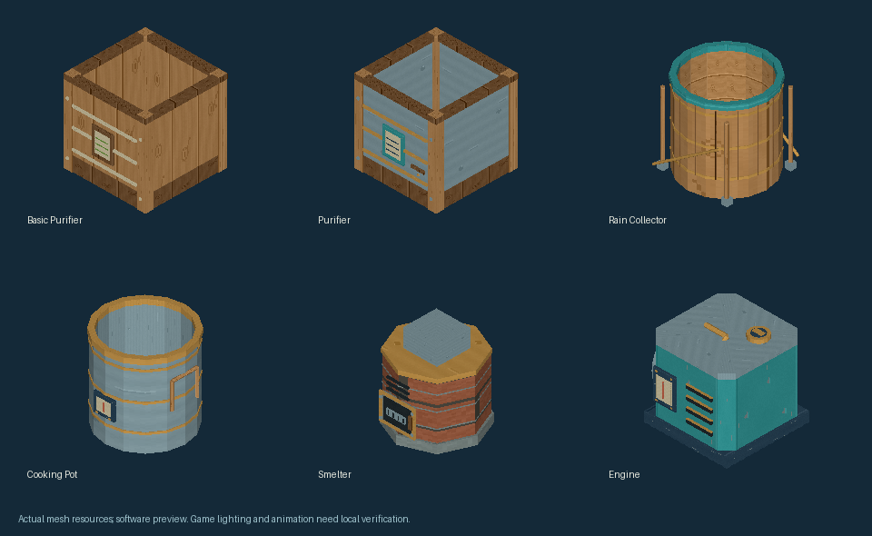

# Survival model refinement — 0.12.2 preview

Five survival stations gain original detail without changing their placement,
mass, recipes, inventories or physical collision shapes:

- Basic purifier: wooden reservoir, cloth bindings and a leaf-filter badge.
- Advanced purifier: metal-lined wooden frame, brass bands, pipe, tap and valve.
- Rain collector: wooden staves, metal bands, teal rim, legs and external braces.
- Cooking pot: metal vessel, wooden side grips, brass bands and front controls.
- Smelter: brick courses, vented door, metal hinges, handle and chimney frame.

Placed mesh models and static/inventory models share the same detailing.
Inventory silhouettes are refitted with the existing native-verified transform.
Original texture materials are reused. Geometry stays inside the preceding
model envelopes; the existing water-floor and opening anchors are retained.
The generation pass removes opaque coplanar overdraw to avoid surface flicker.

This is a software rendering of actual mesh resources, not a Minecraft
screenshot. Game lighting, water levels, food effects and animation need a
local check. Test all four placement rotations, fill/empty the reservoirs,
process a meal and smelt an item. Verify icons in both inventory and JEI.

Existing saves work. Install the same 0.12.2 jar on every client/server.
Regenerate with `python tools/refine_survival_models.py`; the main station
mesh generator also reapplies this refinement after generating its baseline.
